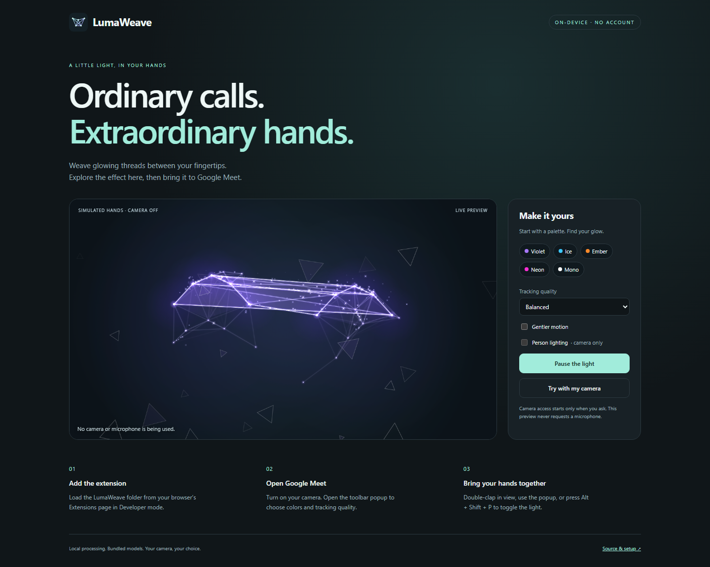

# LumaWeave

**A little light, in your hands.** An independent Manifest V3 extension that draws glowing threads, translucent facets and particles between your fingertips in Google Meet. Tracking runs locally with bundled MediaPipe models; Meet receives the processed camera feed.



[Download the extension](https://github.com/almuzahidseyam/lumaweave/releases/latest) · [বাংলা ব্যবহারবিধি](docs/বাংলা-ব্যবহারবিধি.md) · [Privacy](docs/privacy.md) · [Changes](CHANGELOG.md)

## Install in Chrome or Edge

1. Download `lumaweave-2.0.0.zip` from Releases and extract it.
2. Open `chrome://extensions` or `edge://extensions`, enable **Developer mode**, and choose **Load unpacked**.
3. Select the extracted folder containing `manifest.json`. Pin LumaWeave to the toolbar.
4. Disable any older Meet Plexus installation, reload Google Meet, and turn on your camera.

This is an unpacked developer installation, not a Chrome Web Store listing. Chrome 120+ is declared; a current Chrome/Edge build is recommended. Other browsers are not verified. If your organization blocks developer extensions, follow its browser policy.

## Use

Double-clap with your hands visible to toggle, click the popup's button, or press **Alt + Shift + P**. Everyone receiving your Meet camera feed can see the effect. Color palettes and settings apply while the camera is running.

| Control | What it changes |
| --- | --- |
| Violet, Ice, Ember, Neon, Mono | Five palettes with per-element color overrides |
| Tracking quality | Battery saver: up to 10 submissions/s at 320px; Balanced: 20 at 480px; High quality: about 30 at 640px |
| Gentler motion | Disables flying shards and dissolving dust |
| Fine-tune | Individual elements, footage darkening and light spill |
| Person-aware lighting | Optional second model for subject lighting; uses more CPU/GPU |
| Double-clap gesture | Enables or disables camera gesture activation |
| Clap sound detection | Opt-in analysis of Meet's existing unmuted mic, with a recent-hand gate |
| Import / Export | Portable JSON preferences, validated before use |

Tracking rates are submission limits, not guaranteed video FPS. Hardware, model latency, camera resolution and browser scheduling affect actual performance. Try Battery saver and disable person lighting if the video is slow.

Preferences stay in local extension storage. A one-time migration can read older synced preferences. Saves start immediately and failures are shown in the popup. The effect always starts off for a new Meet camera session.

## Try before a call

Choose **Open camera-free preview** in the popup. Simulated hands show the effect without requesting a camera or microphone. **Try with my camera** opts into a local camera preview; **Stop camera** releases it. The preview never requests microphone access.

Developers can also run the preview on loopback:

```sh
npm ci --ignore-scripts
npm run demo
# Open http://127.0.0.1:4173/demo/index.html
```

The extension itself needs no npm install or build step. Node 22+ is needed only for development, tests and packaging.

## Privacy and scope

LumaWeave has no backend, telemetry or remote model download. Only `storage` is declared, and content scripts target Google Meet alone. Camera frames, hand landmarks and optional person masks are processed in memory. Sound clap is off by default, follows Meet's mic mute state and releases its analyzer when the camera engine stops.

**Google Meet still transmits the processed camera video to the call.** Local inference is not an offline meeting service and does not change Google's meeting/recording behavior. The Meet page shares the main-world hook's execution environment; same-page messaging is not a boundary against a compromised Meet page. See [privacy and permissions](docs/privacy.md).

## Development and checks

```sh
npm ci --ignore-scripts
npm run check
npm test
npx playwright install chromium
npm run test:browser
npm run package
```

- Unit tests cover clap timing, validated settings, immediate/local storage, audio mute/cleanup, segmentation masks, message origins and asynchronous bitmap teardown.
- Browser tests run the actual bundled models with a synthetic camera, check optional person segmentation and camera cleanup, exercise cloned tracks and popup import/export, and load the MV3 extension against a controlled Meet-origin fixture with Trusted Types enforced.
- The fixture does not open an account or join a real call. A two-person Google Meet call with actual hands, microphone clap accuracy and real-device performance remain manual checks.
- `npm run check` also verifies every bundled runtime/model SHA-256 and the manifest's permissions/paths. `npm run package` writes a reproducible installable ZIP and checksum under `dist/`; development dependencies, tests and temporary browser profiles are excluded.

The installed-extension test defaults to Playwright's Chromium. To test with an installed supported browser instead, set `LUMAWEAVE_BROWSER_CHANNEL=msedge` for the test command; preview tests still use Playwright's browser. Linux CI installs the required Chromium system packages automatically.

## Architecture

`getUserMedia` hook → camera-frame stream → hand tracking in an extension iframe → local lighting/weave rendering → generated camera track returned to Meet.

The video path is frame-driven and does not depend on animation frames for Meet processing. Stopping the final camera consumer releases its source, iframe and audio analyzer. Clone consumers keep their pipeline alive until they stop. Detector messages check parent origin, source window, per-instance channel and frame request ID; stale replies are ignored. GPU creation falls back to CPU when unavailable.

## Troubleshooting

- **No status pill:** reload the extension and then reload Meet; check that you selected the folder with `manifest.json`.
- **Waiting for camera:** turn the camera on. A tab opened before installation needs a reload.
- **Tracking failed:** restart the camera; if needed reload Meet. The error pill gives the failing stage. Lower tracking quality on slower devices.
- **Double-clap does not toggle:** keep both hands visible, separate them between claps, or use the keyboard/popup. Sound detection is optional and does not work while the source mic is muted.
- **Preferences not saved:** the popup reports the problem. Reopen/retry, or export your current preferences.

LumaWeave 2.0 evolves the user-provided Meet Plexus 1.1.1 archive. Its imported baseline is preserved in Git history. See [source provenance and third-party notices](THIRD_PARTY_NOTICES.md) for the original archive's licensing status and verified Google model/runtime origins. This project is independent of Google.